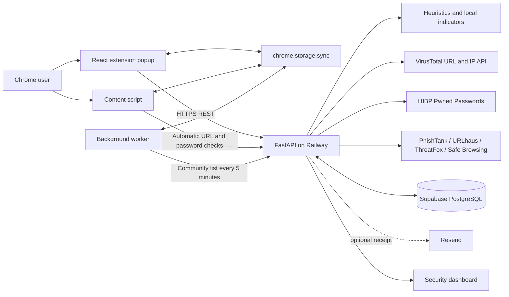

# Piranha End-to-End Architecture and Data Flow

## Main flows

1. **Automatic URL protection:** the content script sends the current URL to Railway. FastAPI combines heuristics, Supabase indicators and reports, cached positive results, and external threat providers. It returns a verdict and evidence; the extension displays a blocking warning for malicious or suspicious results.
2. **Password protection:** Chrome hashes the password locally with SHA-1 and sends only the first five hash characters. The backend requests the padded HIBP range; Chrome matches the remaining suffix locally. Plaintext passwords and complete hashes are never transmitted or stored.
3. **Community reporting:** a report is normalized, rate-limited, and stored in Supabase. The email is converted to a keyed fingerprint before storage. Two distinct reporters produce community evidence; four distinct reporters produce a suspicious verdict and shared blocking. A trusted provider or administrator indicator can confirm and block a threat immediately.
4. **Shared protection:** the extension background worker downloads the corroborated community list every five minutes and combines it with the user's personal list in `chrome.storage.sync`.
5. **Threat cache:** only positive external matches are cached in Supabase. Unknown browsing URLs are not retained as threat-cache records.
6. **Dashboard:** the Railway root page reads aggregate report, reporter, indicator, and cached-threat data without exposing reporter identities.
